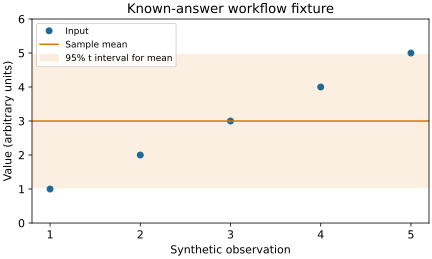

# STAMPED research with agents

A prepared workspace for a second exploratory comparison of research with and without STAMPED skills.
Start with [prompt.md](prompt.md); [preparation notes](PREPARATION.md) summarize the practical lessons and changes to the candidate skills.

Experiments add ordinary files under `experiments/` and dependencies to the root `pixi.toml`.
Concurrent agents use external Git worktrees; their changes merge here.
Inputs and reusable skills can be installed submodules.
Large artifacts and execution records use git-annex, with payloads on [CON Hub](https://hub.centerforopenneuroscience.org/leej3/stamped-ai-research-next).

| Preparation check | Evidence |
|---|---|
| Community-library analysis, independent answer check, two DataLad replays, rejected no-op | [21-check trial](experiments/datalad-annex/README.md) |
| Cold public recipient replay after a documented submodule correction | [15-check recipient trial](experiments/recipient-cold-002/README.md) |
| Real annex upload and independent anonymous retrieval | [Three matching payload hashes](experiments/access/README.md) |
| Locked Linux environment and completed Slurm analysis; local/cluster outputs match | [Job 65719918](experiments/cluster/README.md) |
| Native capture, hook approval, condition exposure and hosted links | [Capture trials](experiments/entire-capture-proof/README.md) |

The toy analysis uses SciPy, pandas and Matplotlib.
These preparation checks establish the tested execution routes, not scientific or skill efficacy.
DataLad 1.7.1 replay uses an explicit compatibility adapter because its native parser does not recognize the Conventional subject prefix.

`skills/` starts from [con/skills PR23](https://github.com/con/skills/pull/23), commit `15da761f63a5a45c507e6596a549720bd43a1e84`.
Adaptations are on [our own branch](https://github.com/con/skills/tree/codex/pr23-stamped-rerun); Austin's source branch is unchanged.
Five study workflows are exposed through `.agents/skills/`, alongside common DataLad and capture guidance.
The launcher verifies their actual exposure for each condition.

Keep working `pixi.lock` files ignored.
The validated toy lock is an ordinary Git blob on [its separate snapshot branch](https://github.com/leej3/stamped-ai-research-next/blob/codex/env-datalad-toy-001/pixi.lock), one commit above `1667b36`; SHA-256 `a4ae3328c4df725aeb2529c0b25d43e0ad5f57fc5ec7c7eb6b82d45806a626ef`.
It is not merged into main.

The [original pilot](https://github.com/leej3/stamped-ai-research) remains intact.
Preparation here does not start the next scientific comparison.
